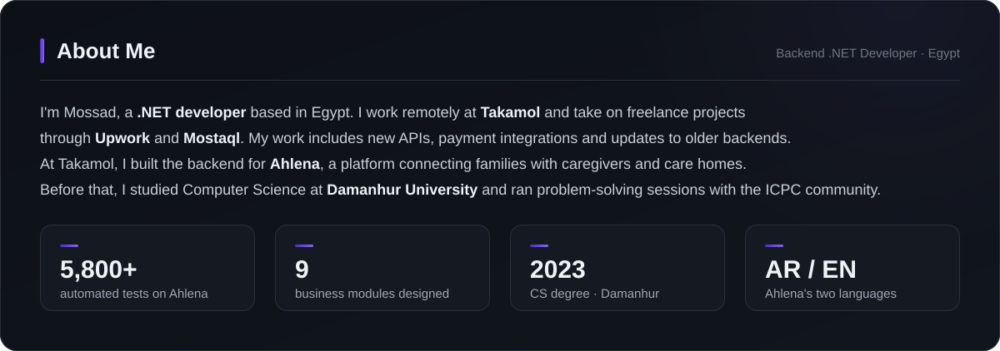
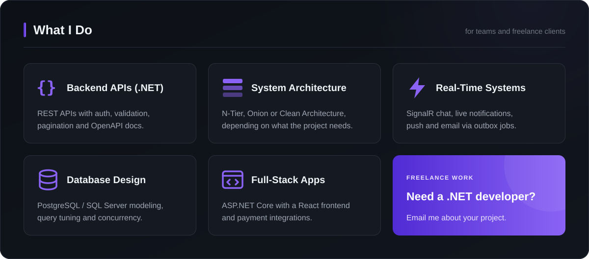
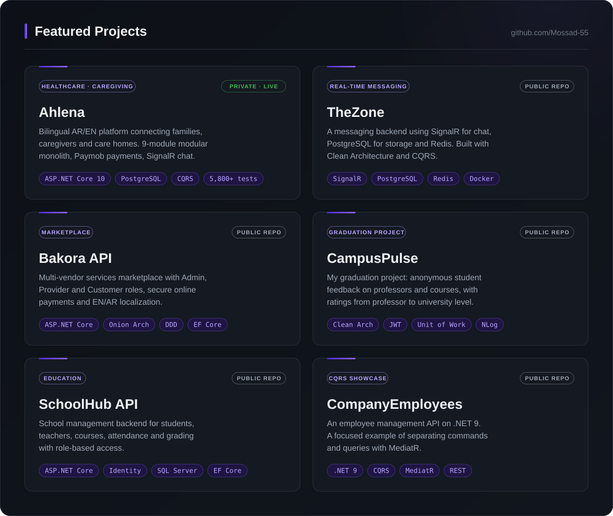
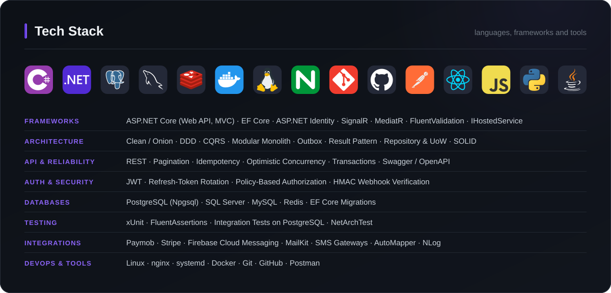
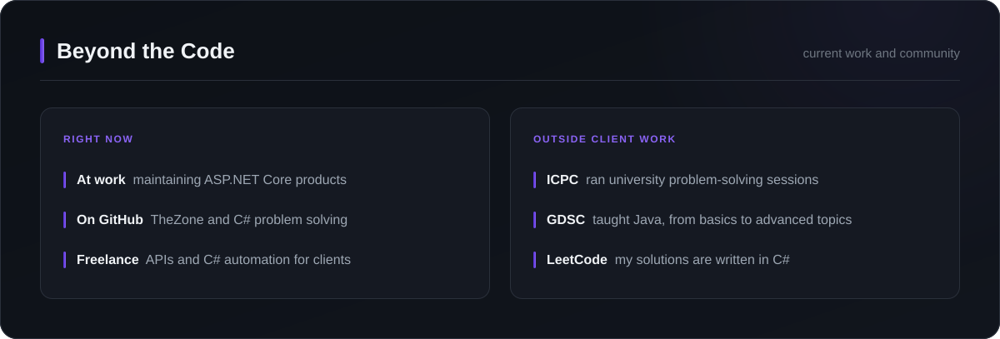
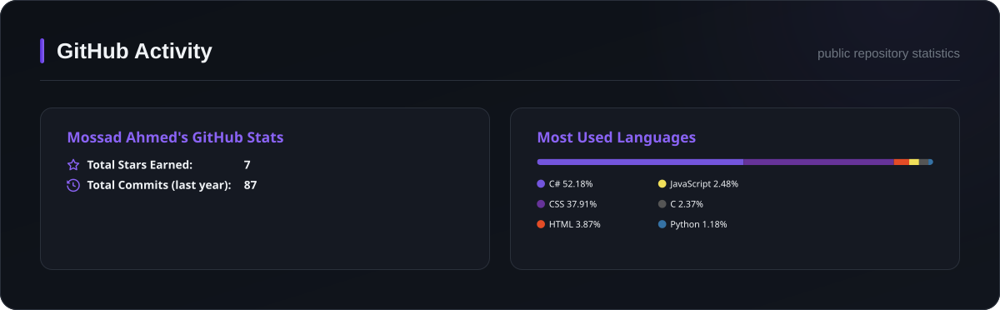

  <a href="https://www.linkedin.com/in/moss-ad-ahmed-28aaa6203/">LinkedIn</a> ·
  <a href="mailto:mosad55522@gmail.com">mosad55522@gmail.com</a> ·
  <a href="tel:+201021417408">+20 102 141 7408</a> ·
  <a href="https://leetcode.com/u/Mossad/">LeetCode</a>

  <a href="https://github.com/Mossad-55/TheZone">TheZone</a> ·
  <a href="https://github.com/Mossad-55/BakoraAPI">Bakora</a> ·
  <a href="https://github.com/Mossad-55/Graduation-Project">CampusPulse</a> ·
  <a href="https://github.com/Mossad-55/SchoolHub-API">SchoolHub</a> ·
  <a href="https://github.com/Mossad-55/CompanyEmployeesCQRS">CompanyEmployees</a> ·
  <a href="https://github.com/Mossad-55/LeetCode-Solutions">LeetCode Solutions</a>

